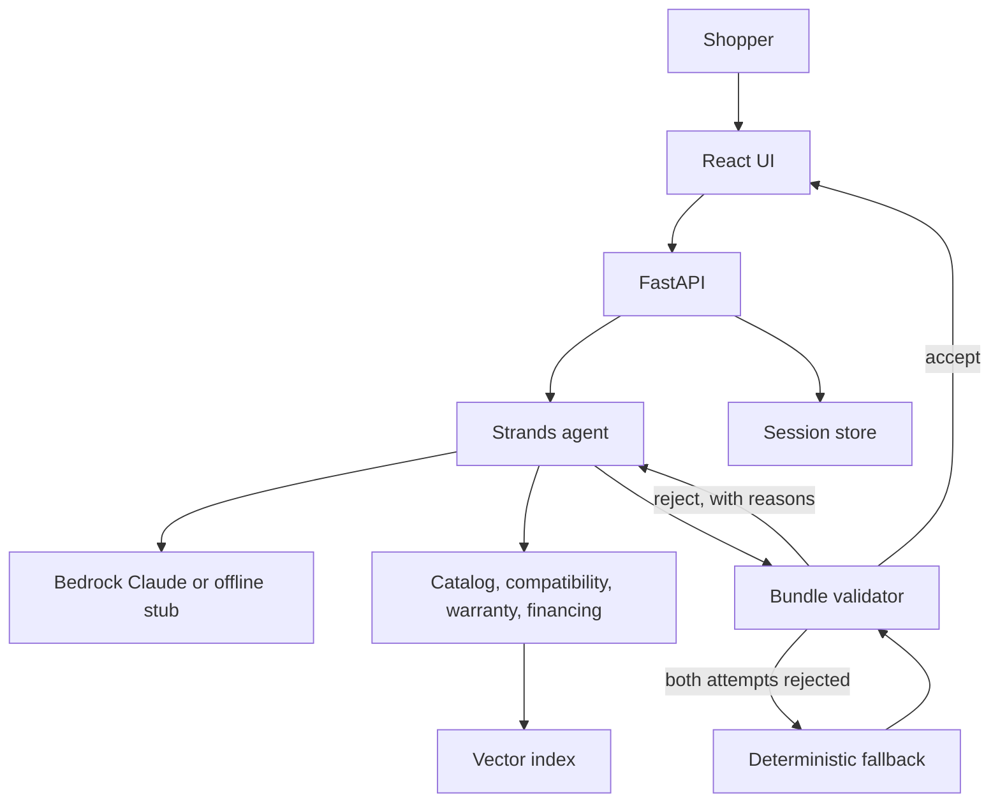

# Kitline

Kitline is a shopping concierge for a small electronics catalog. A shopper describes a setup. An agent searches products, checks accessory compatibility, looks up warranty plans, and reads financing offers. It then submits one package. A deterministic checker prices that package from the catalog and accepts it only when the items exist, the stock covers the quantities, the accessories fit the primary item, the warranty covers that item, the total is inside the budget, and any financing offer is still open.

The catalog, warranty plans, and financing offers are synthetic. The vendors (Northstar, Pixelwell, Harbor) and the lenders (LumenPay, Harbor Credit, Northstar Flex) are fictional.

## Architecture



Offline, the model is a stub that walks the same tool loop inside the Strands SDK, and the vector index is an in-process hashing embedder. With AWS credentials, the model is Claude on Amazon Bedrock and the index can be OpenSearch Serverless or Postgres with pgvector. Titan Text Embeddings v2 is the Bedrock embedder. Session memory is a DynamoDB item per session; locally it is an in-memory map or a JSON file.

The diagrams in [docs/](docs/) draw the wider store: browse, cart, checkout, payments, and the concierge beside them, with Azure equivalents next to the AWS services. This repository implements the concierge. It does not take payment or reserve inventory. The latency table in the low-level diagram is a set of design targets, not a measurement from this code.

## What the checker enforces

The agent submits SKUs and, optionally, a financing offer id. It does not submit prices.

- Exactly one primary line, and no repeated SKU.
- Every product SKU is in the catalog. Every warranty id is a known plan.
- Quantity is within the stock on the catalog record at check time. A warranty quantity is 1.
- Each accessory passes the compatibility rules against the primary item. Docks require a host port. Keyboards, mice, headsets, and monitors in this catalog are universal. Anything else fails closed.
- A warranty plan is active and covers the primary item's vendor and category.
- The grand total, summed from catalog prices, is within the budget when one was given.
- A financing offer is active, unexpired, and covers the total. The monthly installment is computed here.

Strands also checks that the submission matches the `BundleProposal` schema and sends schema errors back to the model. Business failures are separate: the service starts another turn with the checker's reasons. `KITLINE_MAX_ATTEMPTS` defaults to 2. After that, a deterministic builder assembles a simpler package and the same checker runs again. If that also fails, the shopper gets a plain explanation and no package.

## Run it

Python 3.11 or newer, and Node 22 for the UI.

```bash
python3 -m pip install -e "./backend[dev]"
cd backend && python3 -m pytest
```

API and UI, in two shells:

```bash
make api
make web
```

Open http://localhost:5173. The UI proxies `/api` to port 8000. Three example prompts are on the page. Prices, stock, and offers are the synthetic ones in `backend/src/kitline/catalog_data.py`, `warranty.py`, and `financing.py`.

One request from the command line:

```bash
make demo
# or
python3 -m kitline.demo 'Student setup: a light laptop, a mouse, and headphones under $1,200.'
```

Docker, still fully offline:

```bash
docker compose up --build
```

The UI is on http://localhost:8080 and the API is on http://localhost:8000. Sessions are JSON files in a volume.

### AWS

The CDK app in `infra/` describes a Fargate service, a DynamoDB session table, an OpenSearch Serverless vector collection, and a private S3 bucket behind CloudFront. Tasks sit in public subnets, so the template does not add a NAT gateway.

```bash
python3 -m pip install -r infra/requirements.txt
cd infra && python3 app.py
```

That writes `infra/cdk.out`. Deploying needs an account, an image built from `backend/Dockerfile`, and the `ImageUri` parameter. The running container expects Bedrock model access for Claude and Titan embeddings. Set `KITLINE_MODE=bedrock` only when those credentials exist. See `.env.example`.

Optional local stores, after `pip install -e "./backend[stores]"`:

- `KITLINE_VECTOR_STORE=pgvector` and `KITLINE_DATABASE_URL`
- `KITLINE_VECTOR_STORE=opensearch` and `KITLINE_OPENSEARCH_ENDPOINT`
- `KITLINE_SESSION_STORE=dynamodb` and `KITLINE_SESSION_TABLE`

## Trade-offs

- The offline embedder is signed feature hashing with idf weights fit on this catalog. It needs no model download. It will collide, and it is only meant to retrieve inside this fixture. Titan is the embedder when `KITLINE_EMBEDDINGS=bedrock`. The OpenSearch and pgvector adapters store those vectors and return SKUs; price and stock are always read from the catalog record afterwards.
- The stub model follows a fixed tool order so the offline path is repeatable. On Bedrock, Claude chooses the order. Both paths use the same tools, the same schema, and the same checker.
- Two attempts is the default because a rejected package should be corrected once and then give way to a package the checker can prove. Raise `KITLINE_MAX_ATTEMPTS` if you want a hosted model to have more room.
- Financing choice prefers a 0% offer, then the smaller installment. The installment is ordinary amortization rounded half up to the cent. The last payment of a real loan can differ by a few cents; the API returns the regular installment.
- Session memory stores the transcript and the last accepted package. It is not a profile of the shopper.
- The Fargate service has public addresses so a demo stack can omit a NAT gateway. A private subnet with a NAT, or VPC endpoints for Bedrock and OpenSearch Serverless, is the tighter layout and has a standing cost.

## Layout

```
backend/src/kitline/    API, agent, checker, catalog
backend/tests/          pytest
frontend/               React shopper UI
infra/                  AWS CDK app
docs/                   store diagrams, AWS with Azure equivalents
```

## License

MIT. See [LICENSE](LICENSE).
